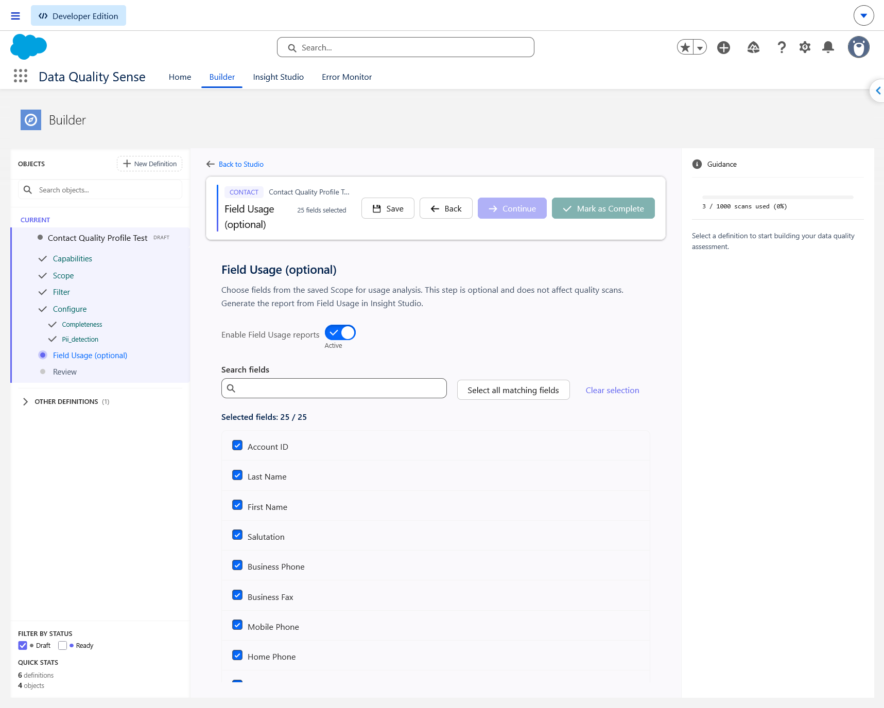
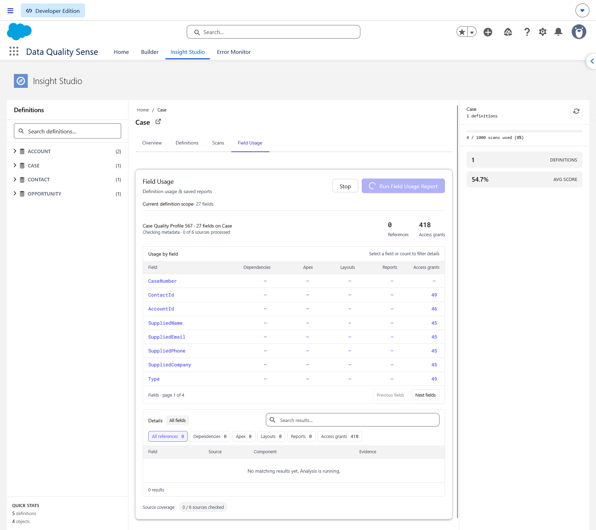
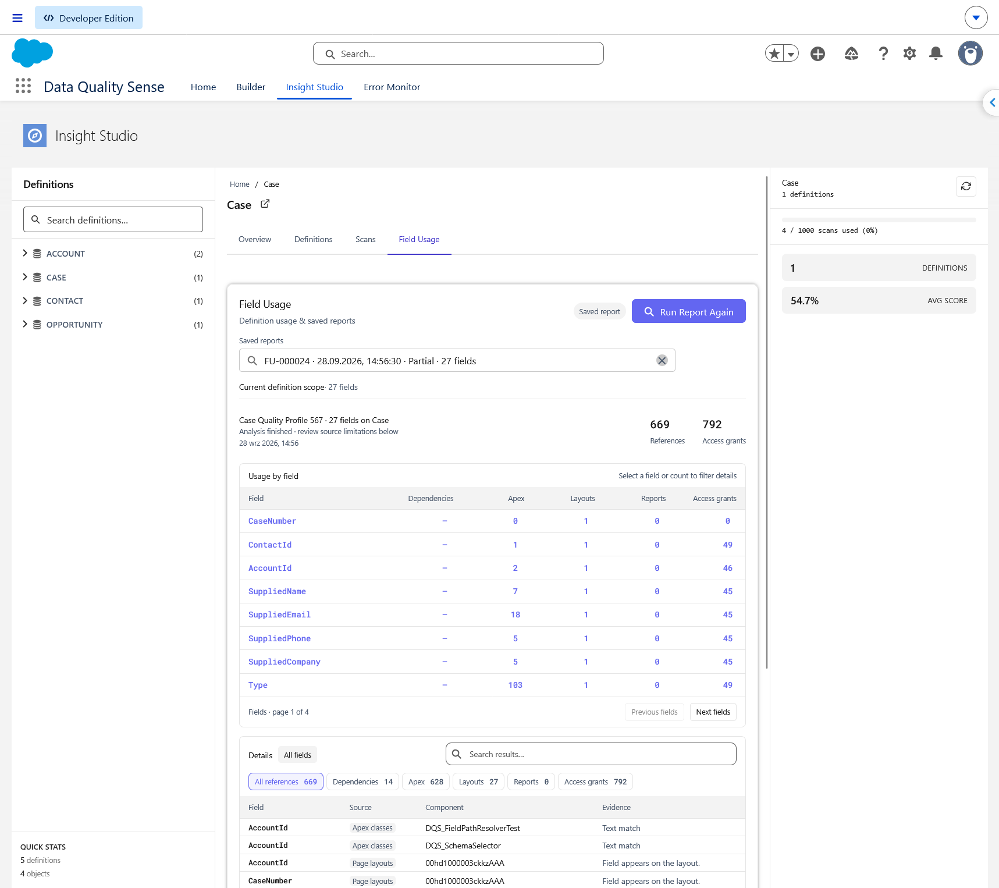
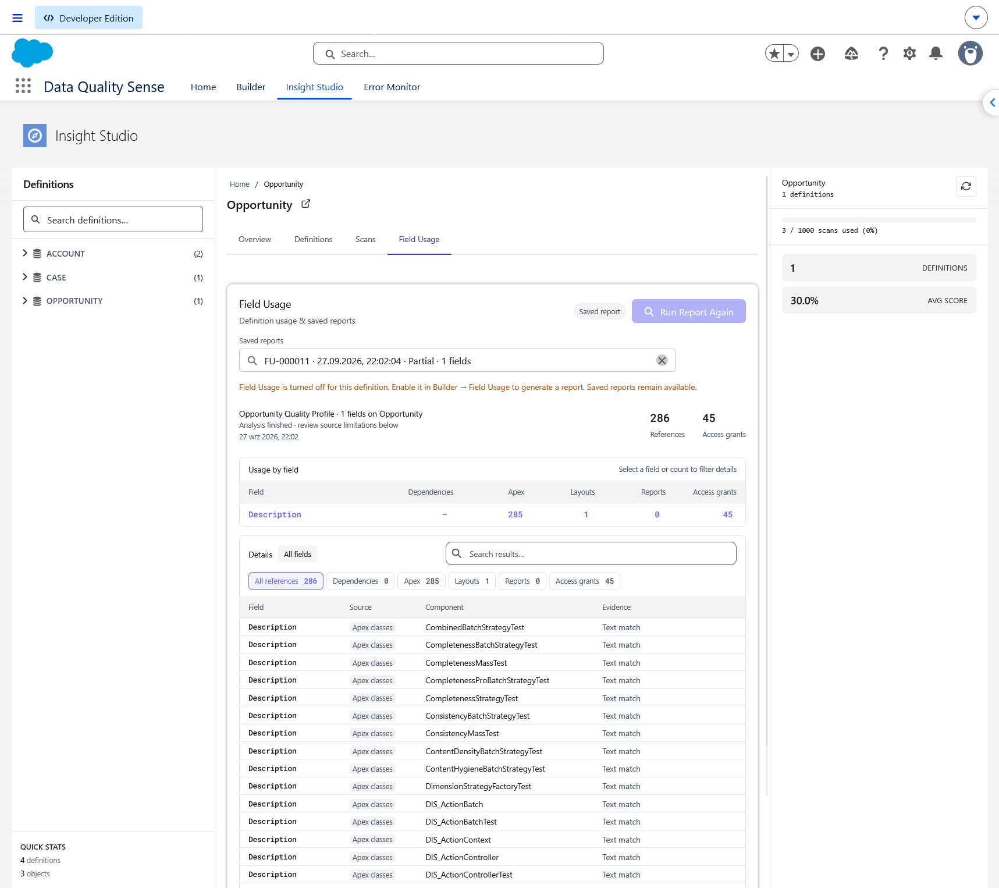

## O que o Field Usage mostra?

O Field Usage encontra referências aos campos selecionados nos metadados do Salesforce: dependências, classes e gatilhos Apex, layouts e relatórios. As permissões **Access grants** aparecem separadamente. Use esta função para investigar referências a um campo antes de alterar sua configuração.

A configuração, a geração, os relatórios salvos e a exportação PDF exigem acesso **DQS Administrator**. Esta análise opcional de metadados não altera pontuações de qualidade nem agendamentos.

## Habilitar relatórios no Builder

1. Abra a definição no [Builder](/pt/builder/overview/) e salve os campos em **Scope**.
2. Depois de **Configure**, abra **Field Usage (optional)**, antes de **Review**.
3. Ative **Enable Field Usage reports**. A função começa desativada para definições novas e existentes. Ao ativá-la, todos os campos acessíveis do Scope salvo são selecionados; desmarque os que deseja excluir.
4. Pesquise pelo rótulo ou nome de API. **Select all** (identificado como **Select all matching fields** na captura) seleciona todo o Scope disponível, incluindo campos fora da pesquisa ou página atual. **Clear selection** remove a seleção. A lista mostra 25 campos por página.
5. Mantenha pelo menos um campo selecionado e clique em **Save** no cabeçalho do Builder antes de continuar.

Reabrir as configurações habilitadas preserva a seleção salva. Campos adicionados posteriormente ao Scope não são selecionados automaticamente; campos removidos ou inacessíveis são excluídos de novos relatórios. Se não houver campos acessíveis, salve campos em Scope primeiro ou deixe Field Usage desativado.

Você pode concluir a definição com Field Usage desativado. Em Configure, **Confirm Configuration** confirma as configurações das capacidades; **Continue** avança para Field Usage. **Mark as Complete** fica disponível em Field Usage e Review quando a configuração obrigatória está concluída e as alterações de Field Usage estão salvas.

## Executar um relatório

1. No Insight Studio, abra **Field Usage** em um objeto ou definição. Na visualização do objeto, escolha uma definição primeiro.
2. Expanda **Current definition scope** para conferir os campos do próximo relatório.
3. Clique em **Run Field Usage Report** (ou **Run Report Again** se um relatório já estiver aberto). O aplicativo verifica as configurações salvas mais recentes e analisa essa seleção. Abrir a aba apenas carrega relatórios salvos.

Os resultados aparecem durante a verificação das fontes. **Stop** encerra a análise e salva os resultados coletados com o status Stopped. Sair da visualização interrompe a análise sem salvar automaticamente o relatório em andamento.

## Ler os resultados

- **Usage by field** mostra os contadores Dependencies, Apex, Layouts, Reports, Needs review e Access grants, com oito campos por página. Clique em um campo ou contador para filtrar os detalhes.
- **Details** mostra Field, Source, Component e Evidence, com pesquisa, filtros de fonte e 15 linhas por página. **All references** contém pares componente/campo confirmados e sem duplicatas. **Needs review** separa correspondências incertas; **Access grants** lista permissões. Essas duas categorias não entram no total de referências confirmadas.
- **0** significa que a fonte foi verificada sem encontrar referências. **—** indica cobertura incompleta sem correspondências coletadas. Verifique a cobertura mesmo quando um contador for positivo.
- A análise Apex/SOQL verifica o contexto do objeto e campo, excluindo comentários, textos de rótulos e referências reconhecidas a outros objetos. Referências de testes ficam ocultas na interface e fora dos totais. Evidências antigas **Text match** são tratadas como **Needs review**. Uma permissão comprova acesso, não uso. Contadores de fontes podem incluir o mesmo componente; não os some.

## Relatórios salvos

Relatórios concluídos ou explicitamente interrompidos são salvos automaticamente. Ao retornar, o mais recente é aberto; **Saved reports** oferece os últimos 50 relatórios da definição. Abrir o histórico não repete a análise. Cada relatório mantém seus campos originais e data de geração, separados do escopo atual.

Desativar Field Usage no Builder impede novos relatórios, mas mantém os salvos disponíveis. Se o salvamento falhar, os resultados continuam visíveis e **Retry Save** tenta novamente sem outra análise. Relatórios acima de 500.000 caracteres JSON permanecem visíveis, mas não são salvos; selecione menos campos para um novo relatório.

## Relatórios automáticos após uma varredura manual

Quando um administrador inicia uma varredura pelo aplicativo DQS (incluindo **Complete & Run Scan**), o diálogo Field Usage abre após o enfileiramento bem-sucedido da varredura de qualidade, se os relatórios estiverem habilitados para a definição. Mantenha o diálogo aberto até terminar ou use **Stop** para salvar resultados parciais. A varredura de qualidade continua separadamente em segundo plano. Varreduras agendadas não geram relatórios Field Usage; a análise exige uma sessão de navegador aberta.

## Abrir componentes referenciados

Nomes compatíveis abrem classes/triggers Apex, layouts, versões de Flow, Permission Sets, perfis ou relatórios na mesma org Salesforce. Outros destinos permanecem como texto; Salesforce continua verificando seu acesso. Relatórios antigos podem precisar de uma nova execução para incluir links ausentes, especialmente os de permissões.

## Baixar PDF

Abra um relatório salvo e clique em **Download PDF** após a análise e o salvamento. O PDF com a identidade visual DQS é armazenado como Salesforce File vinculado ao relatório e inclui escopo, data, cobertura, contadores, evidências e links salvos. Não repete a análise nem exporta violações de qualidade. Evidências incertas e de testes podem aparecer identificadas nos detalhes do PDF, mas não entram no total confirmado.

## Limites de cobertura

Field Usage mostra referências de metadados, não atividade em tempo de execução nem garantia de exclusão segura. Usos de campos padrão em Flows e regras de validação podem ser omitidos: a busca de dependências usa identificadores de campos personalizados. Apex/SOQL dinâmico, tipos não resolvidos, metadados inacessíveis e sintaxe não suportada também limitam a cobertura. Confira **Needs review** e a cobertura antes de alterar campos; zero referências confirmadas não comprova ausência de uso.

As capturas mostram uma versão anterior; o relatório atual também inclui **Needs review**, links de componentes e **Download PDF**.
